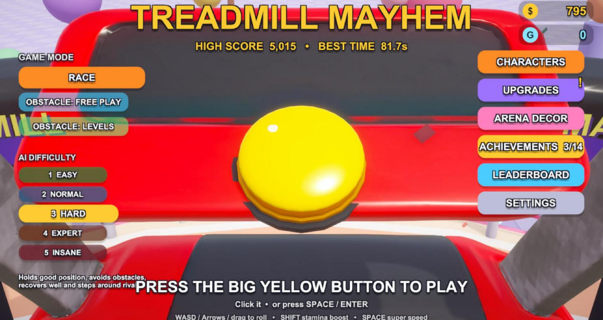
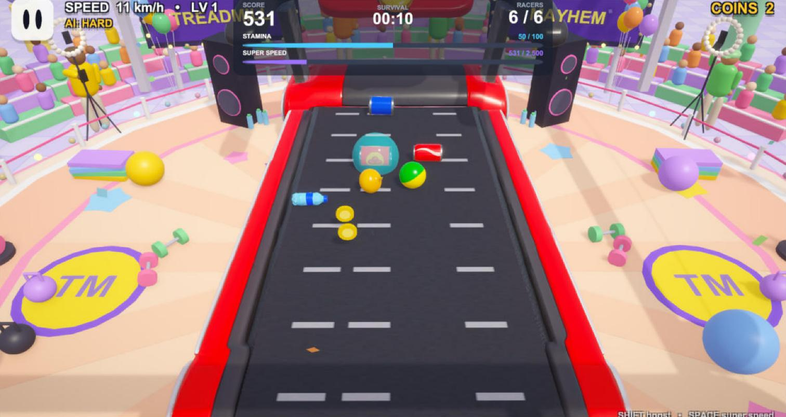
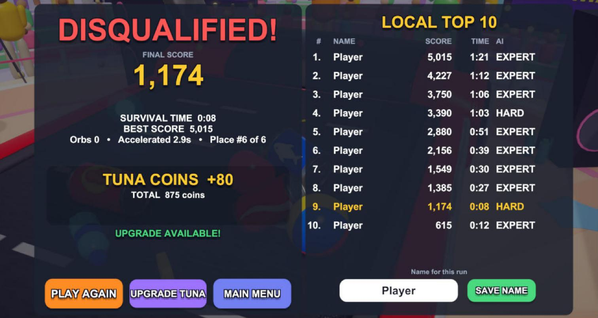
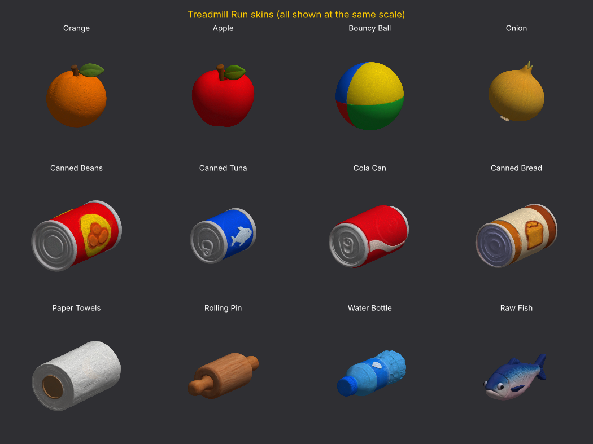

# Treadmill Mayhem

A tuna can, five rival groceries and one treadmill that keeps getting faster. Roll, shove and boost to be the last one standing before the belt throws you off the back.

AME 294: Games and AI, Portfolio Game 3 (Unreal or Unity, Built with AI)
Student: David Benjo

- **Play in the browser (Itch.io):** [ADD LINK AFTER UPLOAD, e.g. https://dbenjo-glitch.itch.io/treadmill-mayhem]
- **Play in the browser (Unity Play):** [ADD LINK AFTER UPLOAD]
- **Download (WebGL build zip):** [ADD GITHUB RELEASE LINK]
- **Prompt log:** [PROMPT_LOG.md](PROMPT_LOG.md)
- **Demo Day presentation:** [docs/Treadmill_Mayhem_Presentation.pdf](docs/Treadmill_Mayhem_Presentation.pdf)



## How to play

1. Pick a **game mode** and an **AI difficulty** on the left of the main menu.
2. Press the **big yellow button** (click it, or press Space / Enter).
3. Stay on the treadmill. The belt pulls everyone toward the back edge and speeds up every few seconds. Fall off the back or sides and you are out.

| Action | Keyboard | Phone |
| --- | --- | --- |
| Roll | WASD or arrow keys | Drag the on-screen stick |
| Stamina boost | Hold Shift (uses stamina) | BOOST button |
| Super Speed | Space, once the bar is full | SUPER button |
| Pause | Esc or P | Pause button, top left |

**Tips**

- Grab the glowing **stamina orbs** to refill your boost.
- Roll in a straight line for about 3 seconds and you hit **ACCELERATION**: you go faster and score 5x as fast.
- Every 2,500 points charges **Super Speed** for a big burst.
- Don't camp in a corner. Hidden no-camp zones warn you after 5 seconds and knock you out at 7. Two warnings also ends your run.



## Game modes

| Mode | What happens |
| --- | --- |
| **Race** | You against five AI racers. Last one on the belt wins. |
| **Obstacle: Free Play** | No rivals. Junk flies down the belt in waves (singles, walls, rollers, rain, zigzags). Survive as long as you can. |
| **Obstacle: Levels** | 12 levels, from "Warm Up" (25 s) to "Tuna Legend" (60 s). Clear a level to earn gears and unlock the next. |

**AI difficulty:** Easy, Normal, Hard, Expert and Insane. Each level changes how fast the rivals react, how well they dodge, whether they chase pickups and how hard they shove you.

## The core loop: Reward, Damage, End

| | In the game | Feedback |
| --- | --- | --- |
| **Reward** | +50 points per second survived, +100 per stamina orb, +250 per second while accelerating. Coins on the belt. Tuna Coins after every run (20 + score / 20, times your coin multiplier), spent on 6 permanent upgrades. Gears in Obstacle Mode for 6 more upgrades. 14 achievements with coin rewards, daily rewards and offline earnings. | Coin and orb sounds, "ACCELERATION!" and "SUPER SPEED!" banners, count-up animations |
| **Damage** | Rivals bump and knock you around, obstacles hit with extra knockback in Obstacle Mode, hits make the can wobble and lose control, camping earns warnings. | Impact and fall sounds, wobble, screen shake, warning banners |
| **End** | **Loss:** you fall off the treadmill, or get disqualified for camping. **Win:** you are the last racer on the belt, or you survive to the end of an Obstacle level. The results screen shows score, time, coins earned and the local top 10, with Play Again, Upgrade and Main Menu. No editor restart needed. | Cheer on a win, fall sound on a loss, new-high-score celebration |



## The racers (Tripo 3D assets)

All 12 racers and the treadmill are Tripo-generated `.glb` models that do real work in the game: the tuna can is the player, and every other model is a playable character and an AI rival with its own physics (size, mass, grip, bounce and wobble).



Prompts, routes and the import pipeline for each asset are in [PROMPT_LOG.md, section 3](PROMPT_LOG.md#3-tripo-3d-asset-pipeline).

## Run it

**Browser:** open one of the play links above. The first load downloads about 117 MB.

**From the Unity project:**

1. Install **Unity 6000.6.7f1** (Unity 6.6) with the **WebGL Build Support** module.
2. Clone this repo and open the folder in Unity Hub. The first import takes a few minutes.
3. Open `Assets/TreadmillMayhem/TreadmillMayhem.unity` and press Play.

**Build it yourself:** in Unity, use **Tools > Treadmill Mayhem > Build WebGL (web textures)**. The Tripo models embed 4096 px uncompressed textures, which would make a ~3 GB build. This tool keeps every texture at its full 4096 px size but stores it compressed, builds to `Builds/WebGL` (117 MB download), then restores the project exactly as it was.

## Tech stack

- Unity 6000.6.7f1, Universal Render Pipeline, C#
- Unity physics (PhysX) for all movement, collisions and the conveyor belt
- glTFast to import the Tripo `.glb` models
- Unity Input System (keyboard and touch)
- All UI is built in code with uGUI (`Scripts/UI/UIKit.cs`)
- Save data is JSON in the player's local app data (WebGL: browser storage)

```
Assets/TreadmillMayhem/
  TreadmillMayhem.unity     the one game scene
  Models/                   Tripo .glb models (player, rivals, treadmill)
  Reference/                ChatGPT reference images that were fed to Tripo
  Prefabs/                  one prefab per racer
  Config/                   ScriptableObjects: game tuning, 5 AI difficulty levels, 12 racer stat sheets
  Scripts/                  gameplay (GameManager, Racer, Treadmill, AIController, ...)
  Scripts/Progression/      upgrades, achievements, levels, characters, decor, daily and offline rewards
  Scripts/Obstacles/        Obstacle Mode spawner, gears, warning markers
  Scripts/UI/               shop, results, pause, characters, achievements, leaderboard
  Scripts/Testing/          the playtest bots
  Editor/                   scene builder, playtest menu, WebGL build tool
docs/screenshots/           images used in this README
```

## References and inspiration

**Concept:** the viral Instagram and TikTok "treadmill race" videos, where cans, fruit and balls are dropped on a running treadmill to see which one stays on longest. The game turns that into a race you control.

**Gameplay references:** Ketchapp-style hypercasual games: one simple rule, instant restarts, satisfying physics, bright simple 3D. The student played Ketchapp games as a kid.

**Target look:** the arena background was inspired by Wii Sports. Bright, toy-like groceries with soft realism, a candy-colored TV-studio arena with a crowd, ring lights, balloons and speakers. Every Tripo prompt ended with the same style line so the set matches (see the prompt log).

**Target sound:** short, punchy arcade effects for coins, orbs, boosts, impacts and falls, plus a crowd cheer for wins.

## AI tools used

| Purpose | Tool |
| --- | --- |
| Code, scene building, testing and debugging | Claude Code (Claude desktop app), model claude-opus-5-5, driving Unity through the Unity MCP server (`com.unity.ai.assistant`) |
| 3D models | Tripo 3D (tripo3d.ai), image-to-3D and text-to-3D |
| Drafting the first design prompt from the student's notes | ChatGPT |
| Reference images for the first models | ChatGPT image generation |
| Playtesting | 50 scripted bot players of varying skill, written and run by Claude |
| Sound effects | Synthesized in code at runtime (`Scripts/AudioFX.cs`), no generative audio tool |
| Presentation slides | Claude (Slides artifact) |

Blender and ElevenLabs were not used.

## Asset attribution

| Asset | Source | License / terms |
| --- | --- | --- |
| 12 racer models and the treadmill (`Models/*.glb`) | Generated by the student with Tripo 3D | Tripo terms of service. [STUDENT: free plan or paid? Models generated on Tripo's free plan are public; check Tripo's current terms for the exact license.] |
| Reference images (`Reference/*.png`) | Generated by the student with ChatGPT | OpenAI terms of use; the user owns the output |
| Sound effects | Synthesized in code | Student's own work |
| Game code, UI, arena decor | Written with Claude Code, directed by the student | Student's own work |
| Unity, URP, glTFast, Input System | Unity Technologies | Unity Terms of Service / Unity Companion License |
| UI font (LegacyRuntime) | Ships with Unity | Unity Terms of Service |
